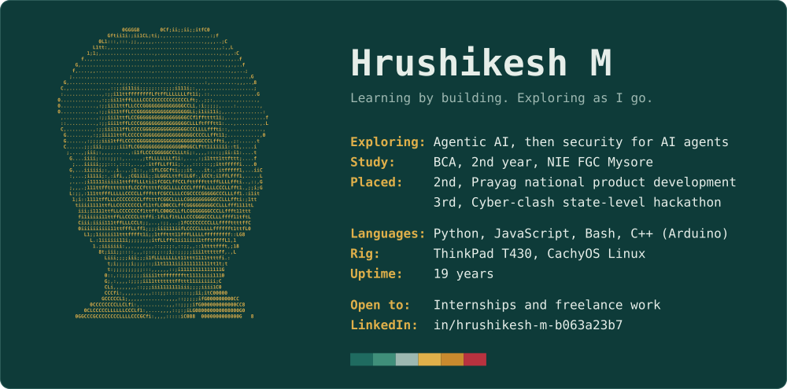

<picture>
  <source media="(max-width: 600px)" srcset="assets/card-dark-narrow.svg">
  
</picture>

I'm a BCA student in Mysore, and I learn by building. Right now that means AI agents with Python and JavaScript. Next, I want to learn how to break them.

## Projects

- **[Vision-Guard](https://github.com/Hrushikesh-Mysore/Vision-Guard)** (Kotlin): an Android app that guards your eyesight, screen privacy and screen time with on-device face detection. It has no internet permission at all. *2nd place at Prayag, a national product development competition.*
- **[Conductor](https://github.com/Hrushikesh-Mysore/Conductor)** (C++20): one planner AI runs your project like a team lead. It plans with you, splits the work into briefs, hands them to free AI workers and reviews every result.
- **[Login-After-Dark](https://github.com/Hrushikesh-Mysore/Login-After-Dark)** (Python, Flask, SQLite): catches suspicious logins, such as account takeover and impossible travel, without flagging night-shift staff. A phone app approves or blocks a device in one tap.
- **[HospitalERP](https://github.com/Hrushikesh-Mysore/HospitalERP)** (React, Vite, Express): a hospital dashboard for patients, appointments, beds and the emergency queue, built in 90 minutes at a hackathon.
- **[claude-code-setup](https://github.com/Hrushikesh-Mysore/claude-code-setup)** (Shell): my Claude Code setup. One `/mode` command switches between research, hackathon, study and project work, and one script backs up and updates every plugin.

Open to internships and freelance work, especially where I get to learn something new. Find me on [LinkedIn](https://www.linkedin.com/in/hrushikesh-m-b063a23b7).
